  
  
  
  
  

<!-- Animated Typing Banner -->

  

  

  
  
  
  

  🎶 <b>Now playing:</b> <i>"First Name, Last Frame"</i> — singing the story of my life 
  ▁ ▂ ▃ ▄ ▅ ▆ ▇ █ &nbsp; ▁ ▂ ▃ ▄ ▅ ▆ ▇ █ &nbsp; ▁ ▂ ▃ ▄ ▅ ▆ ▇ █

---

## 👋 Hey, I'm Stephen!

I'm **Stephen Nguyen (Nguyen Phan Nguyen)**, a **Virginia Tech '27** student studying **Computational Modeling & Data Analytics**, with a background in computer science and interests spanning **agentic AI, language models, and AI music**.

I like building things at both ends of the spectrum: researching how LLMs reason, and making AI systems that can reliably do useful work in the real world. Outside of code, you'll usually find me playing guitar, making music, or dreaming about an AI that can *jam with us* instead of just generating a finished song.

- 🤖 **AI engineering:** tool-using agents, orchestration, reliability, evaluation, and production systems.
- 🔬 **LLM research:** long-context reasoning, retrieval-augmented generation (RAG), LoRA fine-tuning, and reproducible benchmarks.
- 🎵 **AI × music:** human–AI improvisation, music-model evaluation, and creative tools.
- 🌍 **Always curious:** research, startups, and meeting people who want to build something meaningful.

## 📚 Research highlights

| Publication | What we explored | Links |
| --- | --- | --- |
| **π² — COLM 2026** | Co-authored work on **verifiable long-context reasoning data** and **LoRA SFT** of GPT-OSS-20B and Qwen3-4B. Training on **922 verified examples** improved the five-benchmark average by **up to 6.25 percentage points** (20B, low reasoning effort). | [Paper](https://arxiv.org/abs/2604.05114) · [Code & data](https://github.com/vtpss/pi-squared) |
| **SealQA — ICLR 2026** | **Second author**, working with **Dr. Tu Vu**. Built Python-based evaluation tooling around **web crawling, RAG, reranking, grounding, and automated scoring**, with public benchmark resources and **40K reported dataset downloads**. | [Paper](https://arxiv.org/abs/2506.01062) · [Website source](https://github.com/ngstephen1/sealqa.github.io) |

I especially enjoy the part of research where a model *looks* right until a careful evaluation reveals what it's actually getting wrong.

## 🚀 What I'm building

- **[Noteshell](https://noteshell.io/)** — Co-founding an AI workspace where agents turn context and connected data into useful apps, dashboards, documents, and workflows. Built around **TypeScript, React, LLM APIs, and MCP**.
- **Realmusa / MusicJudgeBench** — Ongoing independent research on **AI music co-improvisation** and how we evaluate music-model preferences and interactive behavior. *Research in progress; not all code is public.*
- **[Deloitte π-Rates](https://github.com/ngstephen1/Deloitte-pi-rates)** — A public **agentic fraud-detection** project from the Deloitte Data Competition 2026.
- **[Chuchube Workflow](https://workflow.chuchube.com/)** — Co-founding an **AI coding-agent workflow** product for macOS and Windows, connecting planning, coding, and review in a desktop experience.

## 💼 Experience

| Company | Role |
| --- | --- |
| **[Noteshell.io](https://noteshell.io/)** | Co-founder |
| **[Chuchube](https://workflow.chuchube.com/)** | Co-founder & Head of AI and Data |
| **Virginia Tech** | Student Research Engineer |
| **MoMo** | NLP Research Engineer |
| **Marriott International** | Software Engineer |
| **FPT Software** | AI Engineer Intern |

## 🎼 Music-Coded Tech Stack

### 🎹 Instruments — Programming Languages

 

 

 

### 🎛️ Synths & Plugins — Frameworks & Libraries

 

 

 

 

### 🎚️ Studio Gear — Technologies & Tools

 

 

 

 

 

 

## 🎸 Off the clock

Guitar, AI music experiments, storytelling, and a lot of curiosity about where humans and AI can create things *together*. I also wrote **Meta-Consciousness** and gave a **TEDx talk** about approaching AI with both optimism and care.

## 📈 Contribution activity

  

---

  🎵 If you're into <b>LLMs, agentic systems, AI music, or interesting ideas</b>, let's build something — or jam on something — together. 🎼

  

