<!-- GitHub profile README: ngstephen1/ngstephen1 -->
<!-- Keep fine_ukulele.svg, center-text.svg, right-neon-notes.svg and footer.svg in this repository. -->

  
  
  

  

  
  
  
  

  🎶 <b>Now playing:</b> <i>"First Name, Last Frame"</i> — singing the story of my life 
  ▁ ▂ ▃ ▄ ▅ ▆ ▇ █ &nbsp; ▁ ▂ ▃ ▄ ▅ ▆ ▇ █ &nbsp; ▁ ▂ ▃ ▄ ▅ ▆ ▇ █

👋 Hey, I'm Stephen!
I'm Stephen Nguyen (Nguyen Phan Nguyen), a Virginia Tech '27 student studying Computational Modeling & Data Analytics, with a background in computer science and interests spanning agentic AI, language models, and AI music.

I like building things at both ends of the spectrum: researching how LLMs reason, and making AI systems that can reliably do useful work in the real world. Outside of code, you'll usually find me playing guitar, making music, or dreaming about an AI that can jam with us instead of just generating a finished song.
- 🤖 AI engineering: tool-using agents, orchestration, reliability, evaluation, and production systems.
- 🔬 LLM research: long-context reasoning, retrieval-augmented generation (RAG), LoRA fine-tuning, and reproducible benchmarks.
- 🎵 AI × music: human–AI improvisation, music-model evaluation, and creative tools.
- 🌍 Always curious: research, startups, and meeting people who want to build something meaningful.
📚 Research highlights
Publication	What we explored	Links
π² — COLM 2026	Co-authored work on verifiable long-context reasoning data and LoRA SFT of GPT-OSS-20B and Qwen3-4B. Training on 922 verified examples improved the five-benchmark average by up to 6.25 percentage points (20B, low reasoning effort).	Paper · Code & data
SealQA — ICLR 2026	Second author, working with Dr. Tu Vu. Built Python-based evaluation tooling around web crawling, RAG, reranking, grounding, and automated scoring, with public benchmark resources and 40K reported dataset downloads.	Paper · Website source

I especially enjoy the part of research where a model looks right until a careful evaluation reveals what it's actually getting wrong.
🚀 What I'm building
- Noteshell — Co-founding an AI workspace where agents turn context and connected data into useful apps, dashboards, documents, and workflows. Built around TypeScript, React, LLM APIs, and MCP.
- Realmusa / MusicJudgeBench — Ongoing independent research on AI music co-improvisation and how we evaluate music-model preferences and interactive behavior. Research in progress; not all code is public.
- Deloitte π-Rates — A public agentic fraud-detection project from the Deloitte Data Competition 2026.
- Chuchube — Co-founding an AI coding-agent workflow product for macOS and Windows, connecting planning, coding, and review in a desktop experience.
💼 Experience
Where	What I've worked on
Fidorn.com · Data Scientist	Production AI accounting review workflows for 200 clients / 17,990 transactions; Python, AWS, DynamoDB, Fireworks, stateful task allocation, human review, reliability checks, and LLM evaluation.
Virginia Tech · Student Research Engineer	Search-augmented LLM research with Dr. Tu Vu; co-authored SealQA (ICLR 2026) and π² (COLM 2026).
Chuchube · Co-founder, Head of AI & Data	AI coding-agent workflows and desktop application development for macOS and Windows.
MoMo · NLP Research Engineer	Multilingual customer-intent classification (95.3% macro-F1) and LLM-as-judge quality evaluation across 220K+ conversations.
Marriott International · Software Engineer	Azure OpenAI localization across 11 languages, computer-vision QA assistance, and mobile release/test automation.
FPT Software · AI Engineer Intern	Generative AI, NLP, computer vision, and creative AI projects.

🎼 Music-coded tech stack
🎹 Instruments — Languages
Python · TypeScript / JavaScript · SQL · C / C++ · Rust · Bash

🎛️ Synths — AI, models & retrieval
PyTorch · Hugging Face · LoRA / QLoRA · vLLM · LangGraph / LangChain · RAG · BM25 · Chroma · Neo4j · MCP

🎚️ Studio gear — Infrastructure & apps
AWS (Lambda, S3, DynamoDB) · Azure OpenAI · Docker · Git / CI · Node.js · React / Next.js · Electron · FastAPI
🎸 Off the clock
Guitar, AI music experiments, storytelling, and a lot of curiosity about where humans and AI can create things together. I also wrote Meta-Consciousness and gave a TEDx talk about approaching AI with both optimism and care.
📈 Contribution activity

  

  🎵 If you're into <b>LLMs, agentic systems, AI music, or interesting ideas</b>, let's build something — or jam on something — together. 🎼

  

